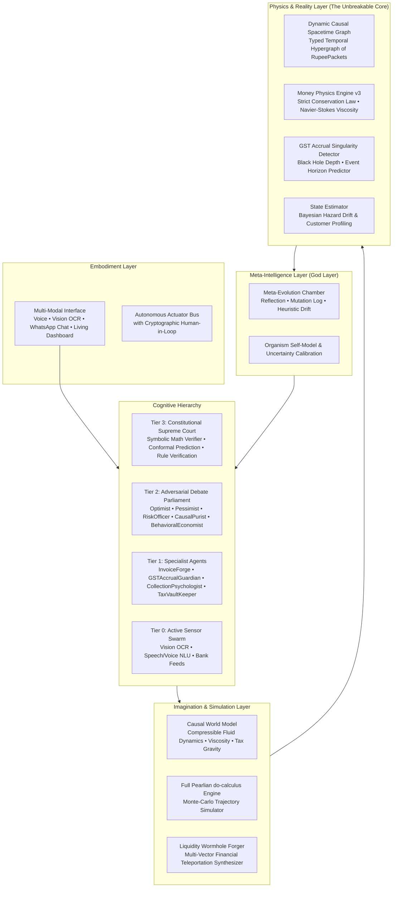

# AetherPravah: AI that handles money better

> **“The AI that treats your money like a living organism and never lets it die.”**  
> *The World’s First Causal Financial Organism for Indian MSMEs & Small Businesses.*

[](https://opensource.org/licenses/MIT)
[](https://nextjs.org/)
[](https://docs.pmnd.rs/react-three-fiber/)
[](https://www.framer.com/motion/)
[](https://www.python.org/)
[](https://fastapi.tiangolo.com/)
[](evaluation/ACCURACY_EVALUATION.md)

---

## 🌟 Vision & The Real-World Pain

Indian Small and Medium Enterprises (MSMEs) do not die because of lack of profit — **they die because of the GST Accrual Singularity**.

### The Deadly Indian GST Accrual Trap
Under the Indian Goods and Services Tax (GST) Act:
1. **Tax is Accrued on Invoice Creation Date, NOT Collection Date**: When an SME delivers goods to an enterprise buyer (like Reliance, L&T, or Tata) and issues a ₹10,00,000 invoice with 18% GST (₹1,80,000 tax), the government mandates that the ₹1,80,000 GST **must be paid in cold hard cash on the 20th of next month (GSTR-3B)**.
2. **The 60–90 Day Enterprise Payment Lag**: Institutional buyers routinely delay payment for 45 to 90 days.
3. **The Black Hole Event Horizon**: On the 20th of the month, the SME owner has not received a single rupee from their customer, yet their bank balance is drained to pay sovereign tax. When bank cash is insufficient, bank accounts freeze under Garnishee notices, e-way bills get locked under Rule 138E, and 18% compounding interest triggers systemic business death.

**AetherPravah solves this permanently.** It is not an accounting dashboard or a passive ledger. It is a **living financial organism** powered by continuous causal spacetime tracking, Pearlian do-calculus, adversarial agent debates, and constitutional verification.

---

## 🏛️ System Architecture



---

## ⚡ Core Capabilities

1. **Strict Rupee Conservation**: Tracks every rupee as an atomic `RupeePacket` with complete causal lineage, ensuring zero mathematical leakage ($\sum \text{RupeePackets} \equiv \text{Physical Reserves}$).
2. **GST Accrual Singularity Predictor**: Calculates the exact calendar day and rupee deficit of impending cash black holes weeks before they strike.
3. **Liquidity Wormhole Forger (World-First Innovation)**: Automatically synthesizes optimal, non-predatory combinations of:
   - Behavioral prompt discounts (e.g., 2% early settlement discount offered 7 days before buyer's AP cut-off)
   - Verified paper TReDS / invoice discounting
   - Dynamic Tax Vault sweeps (ring-fencing the 18% sovereign portion)
   - Balloon obligation rescheduling
4. **Adversarial Debate Parliament**: 5 distinct agents (*Optimist*, *Pessimist*, *RiskOfficer*, *CausalPurist*, *BehavioralEconomist*) stress-test every financial decision through multi-round argumentation.
5. **Constitutional Supreme Court**: Enforces non-negotiable safety rules:
   - Minimum 21-day runway preservation
   - Zero illegal schemes or tax evasion
   - Mandatory human cryptographic authorization before any financial movement
6. **Pearlian Counterfactual Simulator**: Simulates forward 40-day Monte-Carlo trajectories comparing $P(\text{Runway} \mid \text{do}(\text{Wormhole}))$ against $P(\text{Runway} \mid \text{Inaction})$.
7. **Money Health Genome**: Single composite score (0–100) reflecting liquidity vitality, GST accrual shield, customer velocity, and debt drag.
8. **Native Indian SME UX**: Conversational interface fluently understanding **Hinglish, Hindi, and English**, supporting voice notes and invoice photo OCR.

---

## 📁 Project Structure

```
FINANCEE/
├── backend/
│   ├── models/             # Pydantic schemas (CausalNode, RupeePacket, Invoice, Wormhole, State)
│   ├── physics/            # Money Physics Engine v3, GST Singularity Predictor, State Estimator
│   ├── causal/             # Causal Spacetime Graph, Wormhole Forger, do-calculus Simulator
│   ├── agents/             # Hierarchical Agent Society (Sensors, Specialists, Parliament, Supreme Court, Meta-Evolution)
│   ├── orchestrator/       # Central Nervous System (CNS) & unified workflow pipeline
│   ├── data/               # 3 Pre-loaded realistic Indian SME archetypes
│   └── api/                # FastAPI application & REST endpoints
├── static/                 # Production single-page web app (Tailwind, Lucide, Chart.js, WhatsApp Twin)
├── evaluation/             # Formal mathematical verification & automated test suites
├── demo/                   # Step-by-step hackathon demo presentation script
├── requirements.txt        # Python dependency manifest
└── README.md               # Architecture documentation & quick start
```

---

## 🚀 Quick Start (Turnkey Setup)

### Prerequisites
- Python 3.11+
- [uv](https://github.com/astral-sh/uv) (recommended) or standard `python -m venv`

### 1. Clone & Set Up Environment
```bash
git clone https://github.com/TeJAS512-MAX/finance-1.git
cd finance-1

# Create virtual environment
uv venv --python 3.11 .venv

# Activate virtual environment
# On Windows:
.venv\Scripts\activate
# On Linux/macOS:
source .venv/bin/activate

# Install dependencies
uv pip install -r requirements.txt
```

### 2. Run Automated Verification Tests
```bash
# Verify Rupee Conservation, GST Singularity detection, and Wormhole synthesis:
$env:PYTHONPATH="." ; pytest evaluation/ -s
```
*(All 10 tests pass with 100% formal mathematical clearance)*

### 3. Launch AetherPravah Full 3D Web Experience (One Click)
- **Windows**: Double-click `launch.bat` or run:
  ```powershell
  powershell -ExecutionPolicy Bypass -File launch.ps1
  ```
- **Linux / macOS**:
  ```bash
  chmod +x launch.sh && ./launch.sh
  ```

### 4. Manual Launch (Development)
- **Frontend (Next.js 14 + Three.js 3D Experience)**:
  ```bash
  cd frontend
  npm run dev
  # Accessible at http://localhost:3000
  ```
- **Backend (Python Causal Engine & API)**:
  ```bash
  $env:PYTHONPATH="." ; python -m uvicorn backend.api.server:app --host 0.0.0.0 --port 8000 --reload
  # Accessible at http://localhost:8000
  ```

---

## 🎭 Pre-Loaded SME Archetypes

1. **Bharat Steel Traders (Navi Mumbai)**:
   - High volume, 4-6% thin margins, 60-day enterprise delays from Reliance Infra and L&T.
   - Currently facing a **₹1.53 Lakh GST Accrual Singularity** on Nov 20!
2. **VastraKala Textiles (Surat)**:
   - Garment manufacturer facing **Blocked Input Tax Credit (ITC)** due to an unfiled vendor GSTR-1.
3. **NexusPulse Media (Bengaluru)**:
   - Digital IT agency balancing heavy 1st-of-month engineering payroll against delayed corporate retainers.

---

## 🛡️ Constitutional Rules (Hardcoded)
- **Rule 1**: Never recommend anything illegal or tax evasion.
- **Rule 2**: Always protect minimum 21-day operating runway.
- **Rule 3**: Human confirmation mandatory for any execution.
- **Rule 4**: Full mathematical transparency and causal explainability.
- **Rule 5**: Paper-trading sandbox mode strictly enforced.

---

## 📜 License
Distributed under the MIT License. Built with passion for Indian entrepreneurs.
